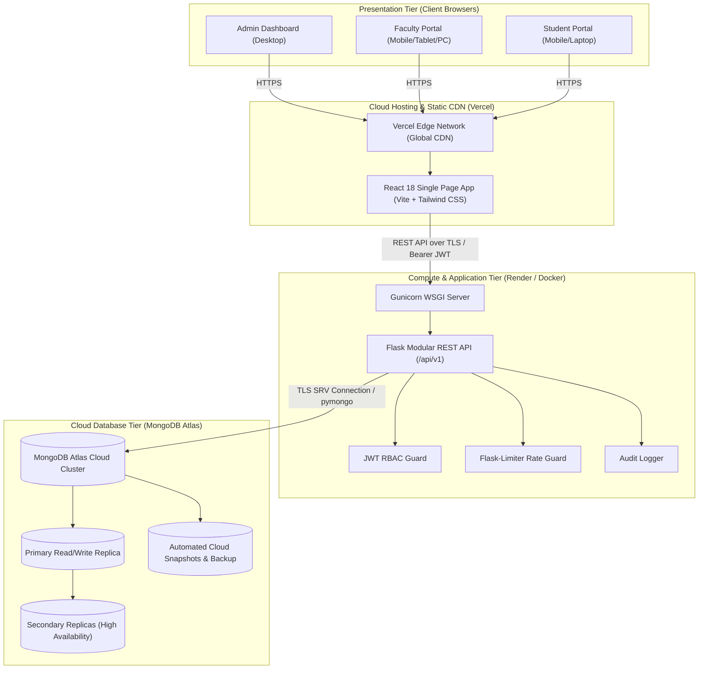
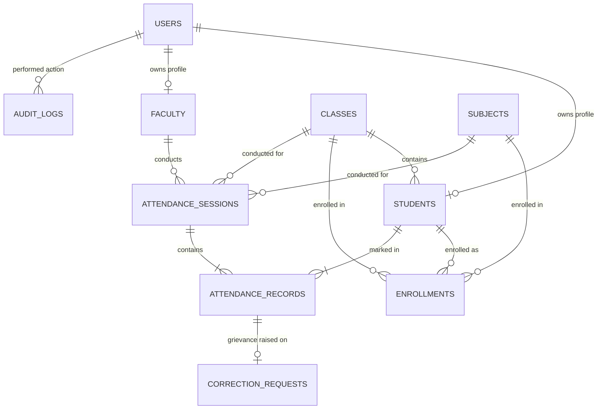

# Cloud-Based Attendance Management System

An enterprise-grade, secure, responsive, and centralized web application designed for academic institutions to manage students, faculty, classes, subjects, attendance sessions, attendance records, and defaulter analytics through a cloud-native architecture.

---

## 1. Abstract

Traditional paper-based attendance registers in academic institutions suffer from physical damage, human record-keeping errors, lack of real-time visibility, time wastage during lectures, and unauthorized proxy attendance. The **Cloud-Based Attendance Management System** replaces paper registers with a centralized, multi-role web platform. Built with a **React.js + Tailwind CSS** frontend, a **Python Flask REST API** backend, and a **MongoDB Atlas** cloud database, this project provides automated percentage calculations, instant defaulter detection, grievance correction workflows, and cloud-native resilience suitable for academic cloud computing demonstrations.

---

## 2. Problem Statement

Manual attendance recording presents several institutional challenges:
- **Data Fragmentation**: Paper registers remain locked in physical faculty rooms, preventing academic deans and parents from accessing real-time attendance trends.
- **Calculation Overhead**: Calculating cumulative attendance percentages and identifying defaulters below the minimum requirement (typically 75%) requires days of manual compilation at semester end.
- **Integrity & Tampering**: Paper registers lack immutable audit trails, making it difficult to verify when, why, or by whom an attendance record was altered.
- **Inaccessibility**: Students have no self-service mechanism to check their attendance progress, resulting in surprise examination disqualifications.

---

## 3. Proposed Solution

A modern, cloud-hosted attendance management platform that:
- Centralizes all institutional academic records in a high-availability cloud database (**MongoDB Atlas**).
- Delivers role-tailored dashboards for **Administrators**, **Faculty Members**, and **Students**.
- Enables rapid attendance roll call with single-click bulk marking and individual exception toggles.
- Enforces an automated finalization lock that requires formal justification reasons for retroactive changes.
- Automatically calculates attendance percentages using clear institutional mathematical rules (excluding excused absences from denominators).
- Provides instant defaulter identification and exports official records to **CSV** and **PDF**.

---

## 4. Project Objectives

1. Digitize attendance operations across classrooms and laboratories.
2. Store records in a centralized, managed cloud database with automated replication and backups.
3. Provide distinct, secure dashboards for Administrators, Faculty, and Students.
4. Ensure accurate, automated attendance percentage computation.
5. Identify students falling below minimum policy thresholds (<75%).
6. Reduce proxy marking and unauthorized data alterations via JWT authentication and audit trails.
7. Demonstrate real cloud computing concepts (on-demand network access, decoupled compute/storage, scalability, fault tolerance).

---

## 5. System Architecture

### Cloud Infrastructure Diagram



---

## 6. Database Design & Entity Relationships

The data model utilizes MongoDB collections structured with compound unique indexes to guarantee integrity and prevent duplicate records.



### Collections Overview
- `users`: Credentials, Bcrypt password hashes, role (`admin`, `faculty`, `student`), activation status.
- `students`: Roll number, class ID, department, semester.
- `faculty`: Employee ID, department, designation, assigned subjects.
- `classes`: Program name, section, semester, academic year.
- `subjects`: Subject code, name, credits, class mappings, faculty mappings.
- `enrollments`: Student-to-subject enrollments.
- `attendance_sessions`: Date, time slot, class, subject, faculty, session type, lock status.
- `attendance_records`: Status (`Present`, `Absent`, `Late`, `Excused`), remarks, unique constraint on `(session_id, student_id)`.
- `correction_requests`: Student attendance grievances, requested status, reason, reviewer remarks.
- `audit_logs`: Immutable chronological log of sensitive changes.

---

## 7. Technology Stack

| Layer | Technologies |
|-------|--------------|
| **Frontend** | React 18, Vite 6, Tailwind CSS, React Router v6, Axios, Recharts, Lucide React, React Hot Toast |
| **Backend** | Python 3.11+, Flask 3.1, Flask-JWT-Extended, Flask-Bcrypt, Flask-Cors, Flask-Limiter, ReportLab |
| **Database** | MongoDB Atlas (Cloud) / PyMongo 4.19 / In-memory MongoMock for offline automated testing |
| **Testing** | Pytest, Flask Test Client, MongoMock |
| **Deployment** | Docker, Gunicorn, Vercel (Frontend), Render (Backend) |

---

## 8. User Roles & Permissions

### Administrator
- Comprehensive institutional dashboard with distribution charts and metrics.
- Full CRUD for Students, Faculty, Classes, and Subjects.
- Institution-wide attendance registers and defaulter reports (<75%).
- CSV and PDF export capabilities.
- Audit log inspection and system threshold configuration.

### Faculty Member
- Scoped to assigned classes and subjects only.
- Open new attendance sessions with time-slot conflict protection.
- Interactive roster with bulk marking (`Mark All Present`), individual status toggles, and remarks.
- Session finalization and locking.
- Review and approve/reject student correction requests.

### Student
- Self-service dashboard with overall attendance gauge and warning notices.
- Subject-wise attendance breakdown and progress bars.
- Complete session-by-session history.
- Comparative subject analytics chart with 75% reference line.
- Submit correction requests with mandatory justification.

---

## 9. Mathematical Calculation Rules

The system applies an institutional formula where **Excused** absences do not penalize students:

$$\text{Attendance Percentage} = \left(\frac{\text{Attended Sessions}}{\text{Eligible Sessions}}\right) \times 100$$

Where:
- $\text{Attended Sessions} = \text{Count}(\text{Present}) + \text{Count}(\text{Late})$
- $\text{Eligible Sessions} = \text{Total Sessions} - \text{Count}(\text{Excused})$

If $\text{Eligible Sessions} = 0$, attendance displays as `N/A`.

### Categorization Thresholds
- **Safe**: Attendance $\ge 80.0\%$ (Green)
- **Warning**: $75.0\% \le \text{Attendance} < 80.0\%$ (Amber)
- **Defaulter**: Attendance $< 75.0\%$ (Rose / Pulse Warning)

---

## 10. Installation & Local Execution

### Prerequisites
- Node.js (v18+) and npm
- Python (v3.10+)

### 1. Backend Setup
```bash
# Navigate to backend directory
cd backend

# Create virtual environment
python -m venv venv

# Activate virtual environment
# Windows:
.\venv\Scripts\activate
# Linux/macOS:
source venv/bin/activate

# Install dependencies
pip install -r requirements.txt

# Seed demo data (Admin, Faculty, 32 Students, Sessions & Records)
python scripts/seed_demo_data.py

# Start Backend Server
python run.py
```
Backend runs at `http://localhost:5000`.

### 2. Frontend Setup
```bash
# Open a new terminal and navigate to frontend directory
cd frontend

# Install node dependencies
npm install

# Start Vite Development Server
npm run dev
```
Frontend runs at `http://localhost:5173`.

---

## 11. Demonstration Accounts

The database seed script generates the following test accounts:

| Role | Identifier / Email | Password | Details |
|------|--------------------|----------|---------|
| **Administrator** | `admin@college.edu` | `Admin@123` | Institutional Admin |
| **Faculty (CS)** | `faculty.cs@college.edu` | `Faculty@123` | Dr. Alan Turing |
| **Faculty (AI)** | `faculty.ai@college.edu` | `Faculty@123` | Dr. Grace Hopper |
| **Student (Safe)** | `23cs001@college.edu` | `Student@123` | Aarav Sharma (~95% attendance) |
| **Student (Warning)**| `23cs002@college.edu` | `Student@123` | Aditi Patel (~77% attendance) |
| **Student (Defaulter)**| `23cs003@college.edu` | `Student@123` | Ananya Verma (~55% attendance) |

---

## 12. Automated Testing Suite

To run the complete automated test suite:

```bash
# Inside backend directory with venv active
pytest tests -v
```

All 9 test suites verify authentication, RBAC boundaries, duplicate prevention, attendance calculation rules, and correction approval workflows.

---

## 13. Cloud Deployment Summary

### MongoDB Atlas Setup
1. Create a MongoDB Atlas cluster and database user.
2. Allow network access (`0.0.0.0/0` or cloud host IP).
3. Copy the SRV URI: `mongodb+srv://<user>:<password>@cluster.mongodb.net/cloud_attendance`.

### Backend (Render / Docker)
- Deploy as a Web Service.
- Set environment variables (`MONGODB_URI`, `SECRET_KEY`, `JWT_SECRET_KEY`, `CORS_ORIGINS`).
- Command: `gunicorn --bind 0.0.0.0:$PORT backend.run:app`.

### Frontend (Vercel)
- Deploy `frontend` directory with Framework preset `Vite`.
- Set environment variable `VITE_API_BASE_URL` to your deployed backend URL.

---

## 14. Conclusion

The **Cloud-Based Attendance Management System** provides educational institutions with a secure, scalable, and centralized cloud solution that eliminates paper registers, prevents unauthorized modifications, automates defaulter reporting, and empowers students with real-time academic transparency.
