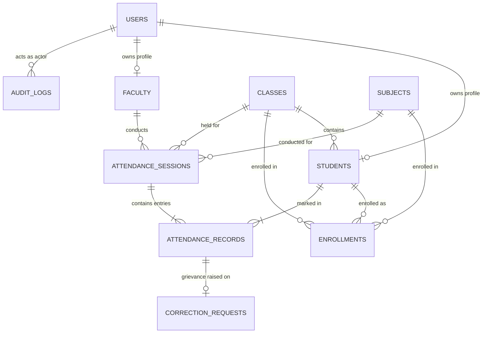

# Database Design: Cloud-Based Attendance Management System

## 1. Entity-Relationship Overview

## 2. Collections and Schema Definitions

### 1. `users`
- `_id`: ObjectId (Primary key)
- `full_name`: String
- `email`: String (Unique index)
- `institution_id`: String (Unique index; e.g. Roll number or Employee ID)
- `password_hash`: String (Bcrypt salt & hash)
- `role`: Enum (`admin`, `faculty`, `student`)
- `is_active`: Boolean
- `created_at`: Timestamp UTC
- `updated_at`: Timestamp UTC
- `last_login_at`: Timestamp UTC

### 2. `students`
- `_id`: ObjectId
- `user_id`: ObjectId (Ref -> `users._id`)
- `roll_number`: String (Unique index)
- `class_id`: ObjectId (Ref -> `classes._id`)
- `department`: String
- `semester`: Integer
- `academic_year`: String
- `created_at`: Timestamp UTC

### 3. `faculty`
- `_id`: ObjectId
- `user_id`: ObjectId (Ref -> `users._id`)
- `employee_id`: String (Unique index)
- `department`: String
- `designation`: String
- `assigned_subject_ids`: Array of ObjectIds
- `assigned_class_ids`: Array of ObjectIds

### 4. `classes`
- `_id`: ObjectId
- `name`: String
- `section`: String
- `academic_year`: String
- `semester`: Integer
- `department`: String
- **Compound Unique Index**: `(name, section, academic_year)`

### 5. `subjects`
- `_id`: ObjectId
- `subject_code`: String (Unique index; e.g. `CS501`)
- `subject_name`: String
- `department`: String
- `semester`: Integer
- `credits`: Integer
- `class_ids`: Array of ObjectIds
- `faculty_ids`: Array of ObjectIds

### 6. `attendance_sessions`
- `_id`: ObjectId
- `class_id`: ObjectId
- `subject_id`: ObjectId
- `faculty_id`: ObjectId
- `session_date`: String (Format: `YYYY-MM-DD`)
- `start_time`: String (`HH:MM`)
- `end_time`: String (`HH:MM`)
- `session_type`: Enum (`Lecture`, `Lab`, `Tutorial`, `Seminar`)
- `room`: String
- `status`: Enum (`Scheduled`, `Open`, `Closed`, `Finalized`)
- `created_by`: ObjectId (Ref -> `users._id`)
- `finalized_at`: Timestamp UTC (nullable)

### 7. `attendance_records`
- `_id`: ObjectId
- `session_id`: ObjectId (Ref -> `attendance_sessions._id`)
- `student_id`: ObjectId (Ref -> `students._id`)
- `status`: Enum (`Present`, `Absent`, `Late`, `Excused`)
- `remarks`: String
- `marked_by`: ObjectId
- `correction_reason`: String (Mandatory for finalized edits)
- `marked_at`: Timestamp UTC
- `updated_at`: Timestamp UTC
- **Compound Unique Index**: `(session_id, student_id)` — *Guarantees one record per student per session, preventing duplicate attendance submissions!*

### 8. `correction_requests`
- `_id`: ObjectId
- `student_id`: ObjectId
- `attendance_record_id`: ObjectId
- `original_status`: String
- `requested_status`: String
- `reason`: String
- `supporting_notes`: String
- `status`: Enum (`Pending`, `Approved`, `Rejected`)
- `reviewed_by`: ObjectId
- `reviewer_comments`: String
- `created_at`: Timestamp UTC
- `reviewed_at`: Timestamp UTC

### 9. `audit_logs`
- `_id`: ObjectId
- `actor_user_id`: String / ObjectId
- `action`: String (e.g. `LOGIN`, `MARK_ATTENDANCE`, `FINALIZE_SESSION`, `UPDATE_STUDENT`)
- `entity_type`: String
- `entity_id`: String
- `previous_value`: Object / String
- `new_value`: Object / String
- `reason`: String
- `ip_address`: String
- `timestamp`: Timestamp UTC
